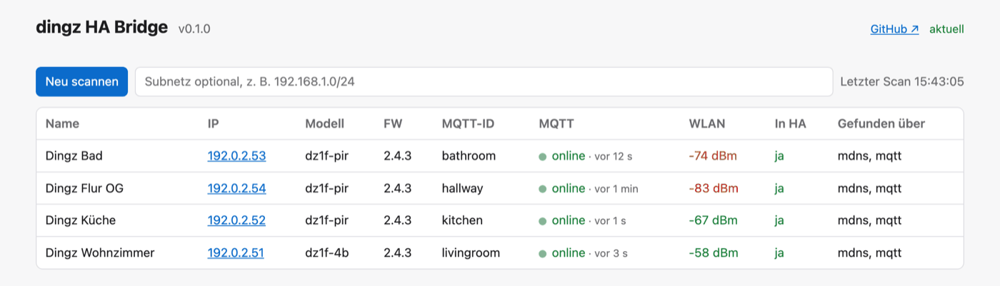

# dingz HA Bridge

[English](README.md) · **Deutsch**

Macht dingz-Schalter (iolo AG), die per MQTT publizieren, über **MQTT Discovery** in Home Assistant bekannt.

- **Keine Übersetzung:** Die Entities zeigen direkt auf die originalen dingz-Topics. Die Bridge muss für die Bedienung nicht laufen, nur zum Erkennen neuer Geräte und Kanäle.
- **Saubere Entities:** Geräte- und Ausgangsnamen sowie Ausgangstypen (dimmbares Licht, Relais, Steckdose → Schalter) kommen aus der HTTP-API der dingz.
- **Provisioning:** dingz im Netz finden (mDNS, MQTT, Subnetz), Status anzeigen und den MQTT-Broker setzen – per Kommandozeile oder kleiner Weboberfläche (Deutsch/Englisch) mit WLAN-Signal und Live-MQTT-Aktivität.
- **Saubere Temperatur:** filtert die auf ganze Grad abgerundeten Werte aus dem Statusdump der dingz, die in HA sonst ein Sägezahnmuster erzeugen.
- **Sicher voreingestellt:** MQTT über TLS (eigene CA, Client-Zertifikate), Weboberfläche nur lokal oder mit Passwort bzw. HA-Ingress, Passwörter werden nie angezeigt.
- **Sofort einsatzbereit:** Home-Assistant-Add-on oder fertiges Docker-Image `ghcr.io/probieri/dingz-ha-bridge` (amd64, arm64).

Status: in Entwicklung, getestet mit Firmware 2.4.3 (`dz1f-4b`, `dz1f-pir`).



📖 **Dokumentation:** [docs/de/](docs/de/README.md) – [Installation](docs/de/installation.md), [Konfiguration](docs/de/configuration.md), [Funktionen](docs/de/features.md), [Weboberfläche](docs/de/web-ui.md), [Kommandozeile](docs/de/cli.md), [Sicherheit](docs/de/security.md), [Fehlersuche](docs/de/troubleshooting.md)

## Was in Home Assistant erscheint

| dingz | HA |
|---|---|
| Ausgang Typ `light` | `light` (Helligkeit nur bei dimmbaren Ausgängen) |
| Ausgang anderer Typ (`power_socket`, …) | `switch` |
| Storen/Motor | `cover` inkl. Lamellen (ungetestet, keine Geräte verfügbar) |
| Front-LED | `light` mit RGB |
| Taster 1–4 (+ externer) | `event` (`p`, `h`, `r`, `m1`…`m5`) |
| PIR | `binary_sensor` motion |
| Temperatur, Helligkeit | `sensor` (°C, lx) |
| Leistung, Energie | `sensor` (W, kWh) |
| Input | `binary_sensor` |

## Einstieg

### Home-Assistant-Add-on

1. `https://github.com/proBieri/dingz-ha-bridge` unter *Einstellungen → Add-ons → Add-on Store → Repositories* hinzufügen.
2. *dingz HA Bridge* installieren und starten (benötigt das Mosquitto-Add-on oder einen anderen Broker der MQTT-Integration).
3. Im Panel **dingz** die Geräte prüfen und bei Bedarf den MQTT-Broker setzen.

### Docker (standalone)

```bash
curl -LO https://raw.githubusercontent.com/proBieri/dingz-ha-bridge/main/docker-compose.yml
curl -L -o .env https://raw.githubusercontent.com/proBieri/dingz-ha-bridge/main/.env.example   # danach Broker-Daten, optional UI-Passwort eintragen
docker compose up -d                  # bezieht ghcr.io/probieri/dingz-ha-bridge (amd64/arm64)
```

Für die mDNS-Suche ist Host-Netzwerk nötig (`network_mode: host`, nur unter Linux zuverlässig).

### Kommandozeile

```bash
pip install ".[ui]"
dingz-ha-bridge run --host 192.168.1.10 --username dingz-ha-bridge --password …   # Bridge
dingz-ha-bridge run --ui                                    # Bridge + Weboberfläche auf 127.0.0.1:8099
dingz-ha-bridge scan [--subnet 192.168.1.0/24]              # dingz im Netz finden
dingz-ha-bridge status 192.168.1.50 --wifi                  # Gerätestatus inkl. WLAN-Signal
dingz-ha-bridge set-mqtt 192.168.1.50 --broker 192.168.1.10 --broker-user dingz
```

Mit TLS: `--tls` (Port 8883) und bei eigener CA `--ca-file ca.pem` – siehe [Sicherheit](docs/de/security.md#tls-zum-broker).

Alle Optionen gehen auch per Umgebungsvariable (`DINGZ_MQTT_HOST`, `DINGZ_MQTT_USERNAME`, …, siehe [Konfiguration](docs/de/configuration.md)); Kommandozeilen-Argumente haben Vorrang.

**Testbetrieb neben einer bestehenden Integration** (z. B. hass-dingz): `--id-prefix dingztest --name-prefix "TEST "` legt einen separaten Satz Geräte an. `--dry-run` zeigt nur, was publiziert würde.

## Sicherheit

- Für die dingz einen eigenen Broker-Benutzer verwenden, per ACL auf `dingz/#` beschränkt, und die dingz wenn möglich in einem eigenen Netzsegment betreiben.
- Die Weboberfläche lauscht standardmässig nur auf `127.0.0.1`. Auf anderen Adressen ist `DINGZ_UI_PASSWORD` Pflicht. Im Add-on ist sie nur über Ingress erreichbar.
- Broker-Passwörter werden nie geloggt und nie an den Browser zurückgegeben.
- Die Weboberfläche prüft serverseitig alle 6 h, ob auf GitHub ein neueres Release existiert. Abschalten mit `--no-update-check` bzw. `DINGZ_UPDATE_CHECK=0`.

Details: [docs/de/security.md](docs/de/security.md).

## Entwicklung

```bash
uv venv -p 3.12 .venv && source .venv/bin/activate   # oder: python3.12 -m venv .venv
uv pip install -e ".[dev,ui]"
pytest
ruff check . && ruff format .
```

Projektwissen (dingz-Protokoll, verifizierte Gerätedetails, Konventionen) steht in [CLAUDE.md](CLAUDE.md), die Roadmap in [docs/PLAN.md](docs/PLAN.md).

## Lizenz

MIT
