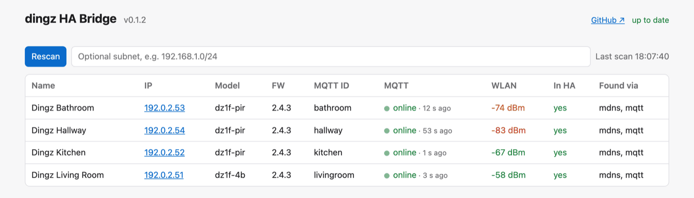

<p align="center">
  
</p>

# dingz HA Bridge

**English** · [Deutsch](README.de.md)

Exposes dingz switches (iolo AG) that publish via MQTT to Home Assistant through **MQTT discovery**.

- **No translation layer:** entities point directly at the original dingz topics. The bridge does not need to run for operating the devices, only to detect new devices and channels.
- **Clean entities:** device and output names as well as output types (dimmable light, relay, socket → switch) come from the dingz HTTP API.
- **Provisioning:** find dingz on the network (mDNS, MQTT, subnet), show their status and set their MQTT broker – via CLI or a small web UI (English/German) with WLAN signal and live MQTT activity.
- **Clean temperature:** filters the whole-degree values of the dingz status dump that otherwise cause a saw-tooth in HA.
- **Secure by default:** MQTT over TLS (own CA, client certificates), web UI only on localhost or behind a password / HA ingress, passwords never shown.
- **Ready to run:** Home Assistant add-on or prebuilt Docker image `ghcr.io/probieri/dingz-ha-bridge` (amd64, arm64).

Status: in development, tested with firmware 2.4.3 (`dz1f-4b`, `dz1f-pir`).



📖 **Documentation:** [docs/en/](docs/en/README.md) – [installation](docs/en/installation.md), [configuration](docs/en/configuration.md), [features](docs/en/features.md), [web UI](docs/en/web-ui.md), [command line](docs/en/cli.md), [security](docs/en/security.md), [troubleshooting](docs/en/troubleshooting.md)

## What appears in Home Assistant

| dingz | HA |
|---|---|
| Output of type `light` | `light` (brightness only for dimmable outputs) |
| Output of another type (`power_socket`, …) | `switch` |
| Blinds/motor | `cover` incl. slats (untested, no device available) |
| Front LED | `light` with RGB |
| Buttons 1–4 (+ external) | `event` (`p`, `h`, `r`, `m1`…`m5`) |
| PIR | `binary_sensor` motion |
| Temperature, illuminance | `sensor` (°C, lx) |
| Power, energy | `sensor` (W, kWh) |
| Input | `binary_sensor` |

## Getting started

### Home Assistant add-on

1. Add `https://github.com/proBieri/dingz-ha-bridge` under *Settings → Add-ons → Add-on Store → Repositories*.
2. Install and start *dingz HA Bridge* (requires the Mosquitto add-on or another broker used by the MQTT integration).
3. Check the devices in the **dingz** panel and set their MQTT broker if needed.

### Docker (standalone)

```bash
curl -LO https://raw.githubusercontent.com/proBieri/dingz-ha-bridge/main/docker-compose.yml
curl -L -o .env https://raw.githubusercontent.com/proBieri/dingz-ha-bridge/main/.env.example   # then fill in broker credentials, optionally a UI password
docker compose up -d                  # pulls ghcr.io/probieri/dingz-ha-bridge (amd64/arm64)
```

Host networking is required for mDNS discovery (`network_mode: host`, reliable on Linux only).

### Command line

```bash
pip install ".[ui]"
dingz-ha-bridge run --host 192.168.1.10 --username dingz-ha-bridge --password …   # bridge
dingz-ha-bridge run --ui                                    # bridge + web UI on 127.0.0.1:8099
dingz-ha-bridge scan [--subnet 192.168.1.0/24]              # find dingz on the network
dingz-ha-bridge status 192.168.1.50 --wifi                  # device status incl. WLAN signal
dingz-ha-bridge set-mqtt 192.168.1.50 --broker 192.168.1.10 --broker-user dingz
```

With TLS: `--tls` (port 8883) and, for an own CA, `--ca-file ca.pem` – see [security](docs/en/security.md#tls-to-the-broker).

All options are also available as environment variables (`DINGZ_MQTT_HOST`, `DINGZ_MQTT_USERNAME`, …, see [configuration](docs/en/configuration.md)); CLI arguments take precedence.

**Test mode next to an existing integration** (e.g. hass-dingz): `--id-prefix dingztest --name-prefix "TEST "` creates a separate set of devices. `--dry-run` only shows what would be published.

## Security

- Use a dedicated broker user for the dingz, restricted to `dingz/#` with an ACL, and keep the dingz in their own network segment where possible.
- The web UI listens on `127.0.0.1` by default. Other addresses require `DINGZ_UI_PASSWORD`. In the add-on it is reachable through ingress only.
- Broker passwords are never logged and never sent to the browser.
- The web UI checks GitHub for new releases (server-side, every 6 h). Disable with `--no-update-check` / `DINGZ_UPDATE_CHECK=0`.

Details: [docs/en/security.md](docs/en/security.md).

## Development

```bash
uv venv -p 3.12 .venv && source .venv/bin/activate   # or: python3.12 -m venv .venv
uv pip install -e ".[dev,ui]"
pytest
ruff check . && ruff format .
```

Project knowledge (dingz protocol, verified device details, conventions) is in [CLAUDE.md](CLAUDE.md), the roadmap in [docs/PLAN.md](docs/PLAN.md).

## License

MIT
