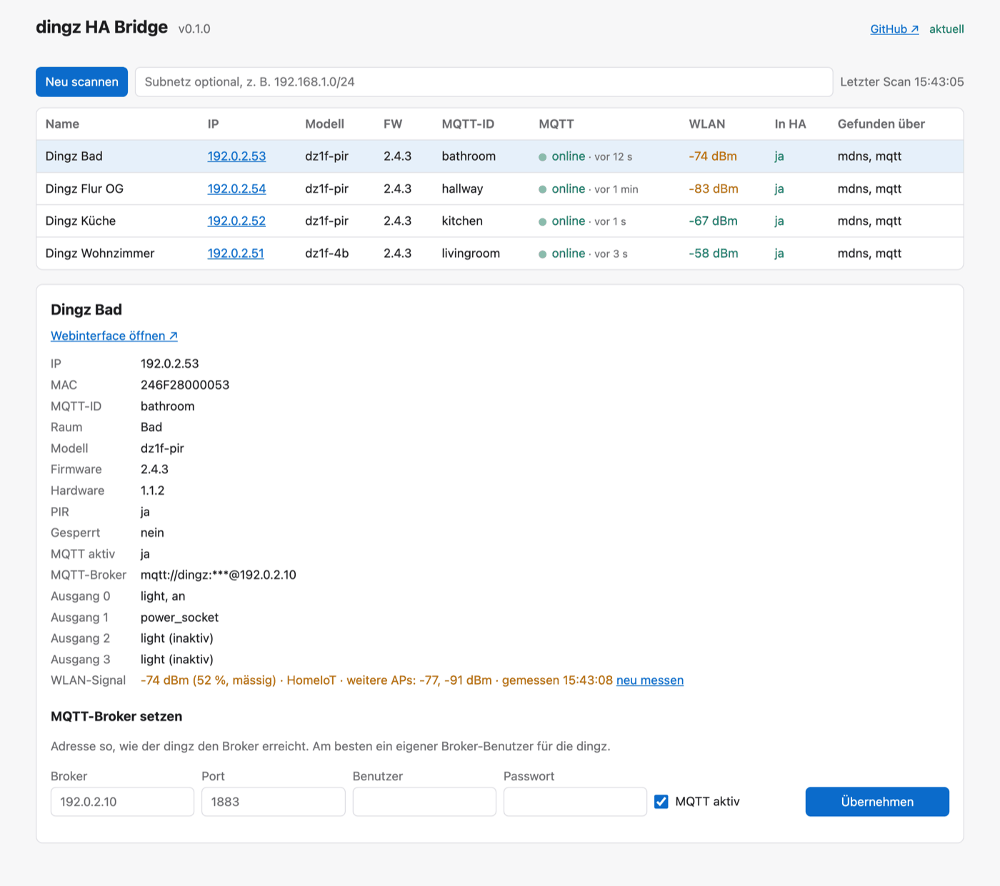

# Weboberfläche

Die Weboberfläche zeigt alle dingz im Netz, ihren Zustand und richtet ihre MQTT-Verbindung ein.

| Betrieb | Aufruf |
|---|---|
| Add-on | Seitenleiste → **dingz** |
| Docker | `http://<server>:8099` (Passwort aus `DINGZ_UI_PASSWORD`, Benutzername beliebig) |
| Python | `dingz-ha-bridge run --ui` → `http://127.0.0.1:8099` |

`run --ui` startet Bridge und Oberfläche zusammen. `ui` startet nur die Oberfläche – dann fehlen die Spalte *In HA* und die MQTT-Aktivität.

> Die Oberfläche gibt es auf Deutsch und Englisch; sie richtet sich nach der bevorzugten Sprache des Browsers (Deutsch, wenn der Browser Deutsch bevorzugt, sonst Englisch). `?lang=de` oder `?lang=en` in der URL erzwingt eine Sprache.

## Kopfzeile

- Version der Bridge.
- **GitHub ↗** – Link auf das Repository.
- Im Add-on navigierst du über die Kopfzeile und die Seitenleiste von Home Assistant rund um die Seite; mit **In Seitenleiste anzeigen** auf der Add-on-Seite bleibt das **Dingz**-Panel in der HA-Seitenleiste. (Die Seite kann keinen eigenen „Zurück“-Link anbieten: Home Assistant führt Ingress-Add-ons in einem abgeschotteten iframe aus, der den umgebenden Rahmen nicht navigieren darf.)
- **Update-Status**: „Update verfügbar: vX.Y.Z ↗“ (mit Link auf das Release), „aktuell“ oder ein Hinweis, warum nicht geprüft werden konnte. Die Bridge fragt GitHub höchstens alle 6 Stunden; abschaltbar mit `--no-update-check` / `DINGZ_UPDATE_CHECK=0` / Add-on-Option `update_check`.

## Geräteliste

Beim Öffnen sucht die Oberfläche automatisch nach Geräten (mDNS und, falls verfügbar, MQTT). **Neu scannen** wiederholt die Suche; im Feld daneben lässt sich zusätzlich ein Subnetz angeben (z. B. `192.168.1.0/24`), etwa wenn mDNS nicht funktioniert.

| Spalte | Inhalt |
|---|---|
| Name | Gerätename aus dem dingz |
| IP | Link auf das **Webinterface des dingz** (neuer Tab) |
| Modell, FW | Front-Modell und Firmware |
| MQTT-ID | `<id>` in den Topics `dingz/<id>/…` |
| MQTT | `online` / `offline` laut `dingz/<id>/online`, **Aktivitätspunkt** und Zeit seit der letzten Nachricht |
| WLAN | Signalstärke in dBm, farbig nach Qualität |
| In HA | ob die Bridge für das Gerät eine Discovery-Config publiziert hat |
| Gefunden über | `mdns`, `mqtt`, `http` (Subnetz) |

### MQTT-Aktivität

Der Punkt in der Spalte *MQTT* leuchtet bei **jeder** empfangenen Nachricht des Geräts kurz grün auf. Daneben steht, wie lange die letzte Nachricht her ist; der Tooltip zeigt ihr Topic (z. B. `dz1f-4b/sensor/light`). Grau bedeutet: seit dem Start noch keine Nachricht. Die Liste aktualisiert sich jede Sekunde.

Zur Orientierung: Jeder dingz sendet mindestens alle 5 Minuten einen kompletten Status, die Helligkeit oft alle 10–20 Sekunden, Taster und Schaltvorgänge sofort.

### WLAN-Signal

| dBm | Bewertung | Farbe |
|---|---|---|
| ≥ −60 | sehr gut | grün |
| −60 bis −70 | gut | grün |
| −70 bis −80 | mässig | orange |
| < −80 | schlecht | rot |

Die dingz-API meldet die Stärke der aktuellen Verbindung nicht direkt. Die Bridge lässt den dingz deshalb einen WLAN-Scan machen (~2 s) und zeigt den **stärksten Access Point der eigenen SSID** – in der Regel der, mit dem er verbunden ist. Die Geräte werden nacheinander gemessen; ein Messwert gilt 5 Minuten.

## Gerätedetails

Klick auf eine Zeile öffnet die Details. Ein Link mit `#<ip>` (z. B. `http://127.0.0.1:8099/#192.168.1.51`) öffnet sie direkt.

- Link **Webinterface öffnen ↗**
- IP, MAC, MQTT-ID, Raum, Modell, Firmware, Hardware, PIR vorhanden, Gerätesperre
- MQTT aktiv und Broker (Passwort als `***`)
- Ausgänge mit Typ und Zustand
- WLAN-Signal mit allen sichtbaren Access Points der SSID, Messzeit und **neu messen**

## MQTT-Broker setzen

Im Detailbereich (*MQTT-Broker setzen*):

| Feld | Inhalt |
|---|---|
| Broker | Adresse, unter der **der dingz** den Broker erreicht (LAN-IP) |
| Port | Standard 1883 |
| Benutzer, Passwort | Broker-Zugang für die dingz (eigener Benutzer empfohlen) |
| MQTT aktiv | MQTT auf dem dingz ein- oder ausschalten |

**Übernehmen** fragt nach einer Bestätigung, schreibt die Einstellung auf den dingz, liest sie zurück und meldet, ob der dingz sie übernommen hat. Das Passwort wird nicht gespeichert und nie zurückgegeben.

> Das Schreibformat der dingz-API ist für Firmware 2.x nicht offiziell dokumentiert. Meldet die Oberfläche, dass der dingz die neuen MQTT-Einstellungen nicht übernommen hat, die Einstellung über das Webinterface des dingz vornehmen.

## Absicherung

- Standalone lauscht die Oberfläche nur auf `127.0.0.1`. Für andere Adressen ist ein Passwort Pflicht, sonst startet sie nicht.
- Im Add-on ist sie nur über Home-Assistant-Ingress erreichbar.
- Details: [Sicherheit](security.md#weboberfläche).
