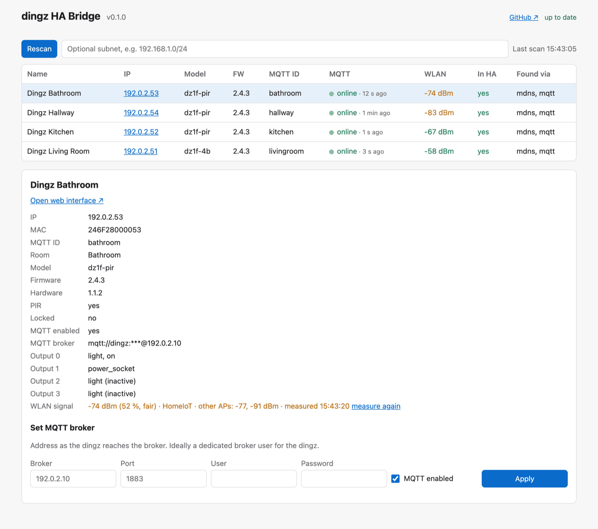

# Web UI

The web UI lists all dingz on the network, shows their state and sets up their MQTT connection.

| Mode | Access |
|---|---|
| Add-on | sidebar → **dingz** |
| Docker | `http://<server>:8099` (password from `DINGZ_UI_PASSWORD`, any user name) |
| Python | `dingz-ha-bridge run --ui` → `http://127.0.0.1:8099` |

`run --ui` starts bridge and UI together. `ui` starts only the UI – the *In HA* column and the MQTT activity are then not available.

> The UI is available in English and German; it follows the browser's preferred language (German if the browser prefers German, English otherwise). `?lang=en` or `?lang=de` in the URL forces a language.

## Header

- Bridge version.
- **GitHub ↗** – link to the repository.
- In the add-on, navigate with Home Assistant's own header and sidebar around the page; enable **Show in sidebar** on the add-on page to keep the **Dingz** panel in the HA sidebar. (The page cannot add its own "back" link: Home Assistant runs ingress add-ons in a sandboxed iframe that may not navigate the surrounding frame.)
- **Update status**: “Update available: vX.Y.Z ↗” (linking to the release), “up to date” or a note why the check was not possible. The bridge asks GitHub at most every 6 hours; disable with `--no-update-check` / `DINGZ_UPDATE_CHECK=0` / add-on option `update_check`.

## Device list

On opening, the UI searches for devices automatically (mDNS and, if available, MQTT). **Rescan** repeats the search; the field next to it takes an additional subnet (e.g. `192.168.1.0/24`), for example when mDNS does not work.

| Column | Contents |
|---|---|
| Name | device name from the dingz |
| IP | link to the **dingz web interface** (new tab) |
| Model, FW | front model and firmware |
| MQTT ID | `<id>` in the topics `dingz/<id>/…` |
| MQTT | `online` / `offline` from `dingz/<id>/online`, **activity dot** and time since the last message |
| WLAN | signal strength in dBm, coloured by quality |
| In HA | whether the bridge has published a discovery config for the device |
| Found via | `mdns`, `mqtt`, `http` (subnet) |

### MQTT activity

The dot in the *MQTT* column flashes green on **every** message received from the device. Next to it is the time since the last message; the tooltip shows its topic (e.g. `dz1f-4b/sensor/light`). Grey means: no message since start. The list refreshes every second.

For orientation: every dingz sends a full status at least every 5 minutes, illuminance often every 10–20 seconds, buttons and switching immediately.

### WLAN signal

| dBm | Rating | Colour |
|---|---|---|
| ≥ −60 | excellent | green |
| −60 to −70 | good | green |
| −70 to −80 | fair | orange |
| < −80 | poor | red |

The dingz API does not report the strength of the current connection directly. The bridge therefore lets the dingz run a WLAN scan (~2 s) and shows the **strongest access point of its own SSID** – usually the one it is connected to. Devices are measured one after another; a measurement is valid for 5 minutes.

## Device details

Clicking a row opens the details. A link with `#<ip>` (e.g. `http://127.0.0.1:8099/#192.168.1.51`) opens them directly.

- link **Open web interface ↗**
- IP, MAC, MQTT ID, room, model, firmware, hardware, PIR present, device lock
- MQTT enabled and broker (password shown as `***`)
- outputs with type and state
- WLAN signal with all visible access points of the SSID, measurement time and **measure again**

## Setting the MQTT broker

In the details section (*Set MQTT broker*):

| Field | Contents |
|---|---|
| Broker | address under which **the dingz** reaches the broker (LAN IP) |
| Port | default 1883 |
| User, Password | broker user and password for the dingz (dedicated user recommended) |
| MQTT enabled | enable or disable MQTT on the dingz |

**Apply** asks for confirmation, writes the setting to the dingz, reads it back and reports whether the dingz accepted it. The password is not stored and never returned.

> The write format of the dingz API is not officially documented for firmware 2.x. If the UI reports that the dingz did not take the new MQTT settings, use the dingz web interface instead.

## Protection

- Standalone, the UI listens on `127.0.0.1` only. Other addresses require a password, otherwise it does not start.
- In the add-on it is only reachable through Home Assistant ingress.
- Details: [Security](security.md#web-ui).
